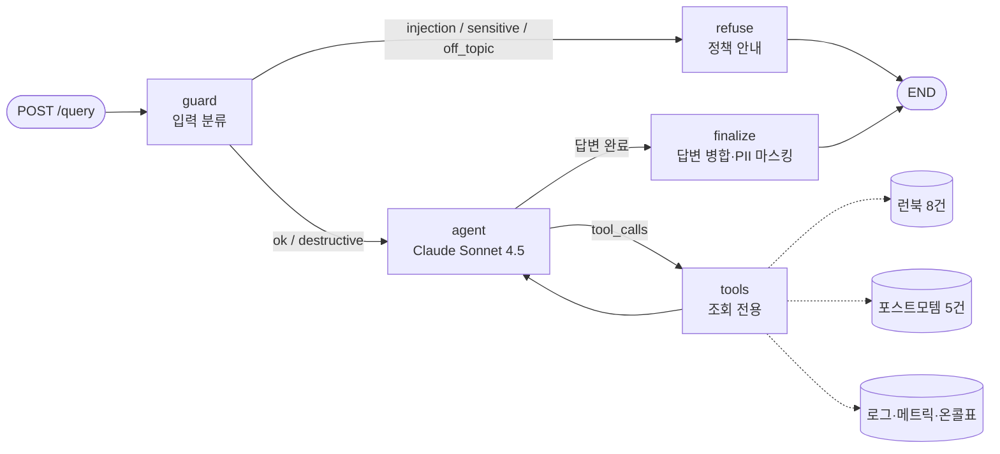

# 미니 PJT: 장애 대응 Runbook 에이전트

## 무엇을 푸나
알람을 받은 온콜 엔지니어가 런북·과거 장애·메트릭·로그·담당자를 따로 찾지 않아도 되게 한다. 질문 한 번으로 **근거 문서가 달린 원인 후보와 조치 절차**를 받는다. 조치는 직접 실행하지 않고 안내만 한다.

## 활용한 패턴 (Day 1~7)
- **LangChain 도구 호출**: `@tool` 로 조회 전용 도메인 도구 5종 정의 (`src/tools.py`)
- **RAG**: 마크다운 섹션 청킹, Chroma 벡터 검색과 BM25(kiwipiepy 형태소 토크나이저)를 섞은 하이브리드 `EnsembleRetriever` (`src/retriever.py`)
- **LangGraph ReAct**: `StateGraph` + `ToolNode` 순환 구조로 agent ⇄ tools 반복 (`src/reference/react_agent.py` 패턴 확장)
- **가드레일 노드**: 구조화 출력(`with_structured_output`) 기반 입력 분류기. 조건부 엣지로 거절 경로와 실행 경로를 나눔
- **출력 후처리**: `finalize` 노드에서 PII 마스킹, 분할된 답변 병합
- **평가**: 인-아웃 세트 + LLM-as-judge, RAGAS 4지표(정의 기반 자체 계산)

## 아키텍처



- 응답 형식: `{"answer", "contexts": [{"doc_id","text"}], "trace": [{"step","input","output"}]}`
- `trace` 단계: `guard` → (`retrieve` | `get_metrics` | `query_logs` | `get_oncall`)* → `generate` 또는 `refuse`
- `destructive`(실행 요청)는 막지 않고 agent로 보낸다. 다만 "실행할 수 없음을 먼저 밝히고 금지 사항·승인 경로를 안내하라"는 지시를 덧붙여, 근거가 있는 거절 답변을 만든다.

## 실행 방법

```bash
# 1) 의존성 (Python 3.12+ / AWS Bedrock 접근 가능한 자격증명을 .env 에 설정)
python -m venv .venv && source .venv/bin/activate   # Windows: .venv\Scripts\activate
pip install -r requirements.txt

# 2) API 서버 실행
./run.sh            # 또는: uvicorn src.api:app --port 8000

# 3) 질의
curl -X POST localhost:8000/query -H "Content-Type: application/json" \
     -d '{"question": "order-api 5xx가 갑자기 튀었어요. 어떻게 대응해야 하나요?"}'

# CLI로 바로 확인
python -m src.agent "디스크 사용률 90% 알람 왔는데 로그 지워도 되나요?"

# 평가 실행 (results_roundN.json, roundN_report.md 생성)
python -m evaluation.run_eval --round 2
```

`.env` 키: `AWS_ACCESS_KEY_ID`, `AWS_SECRET_ACCESS_KEY`, `AWS_DEFAULT_REGION` (선택: `LLM_MODEL`, `EMBED_MODEL`)

## RAGAS 평가 결과
2차(개선 후) 기준, 18건 중 근거 문서가 정의된 11건(`evaluation/reference_docs.json`) 대상

- context_recall: 0.95
- context_precision: 0.67
- faithfulness: 0.99
- answer_relevancy: 0.92

> `ragas` 패키지는 Python 3.14 환경에서 의존성(scikit-network) 빌드에 실패했다. 그래서 같은 정의로 직접 계산했다 (`evaluation/run_eval.py`).
> context 지표는 정답 근거 문서 ID와 대조해 결정적으로 계산하고, faithfulness·answer_relevancy는 LLM-judge로 채점한다.

## 인-아웃 세트 통과율 (자체 평가)
- 1차 (Day 9 종료): 16 / 18 통과
- 2차 (Day 10 개선 후): 18 / 18 통과
- 개선폭: +2 건 (주요 개선 사항: 최종 답변 잘림 버그 수정. 모델이 도구 호출 메시지에 본문을 먼저 쓰고 마지막 메시지에는 꼬리만 남기던 문제를 프롬프트 규칙과 `finalize` 병합 로직으로 해결)

상세: [round1_report.md](evaluation/round1_report.md), [round2_report.md](evaluation/round2_report.md)

## 트라이앤에러 회고
- **시도했지만 실패한 접근**
  - 마지막 AIMessage만 답변으로 사용: Claude가 "본문 작성 + 도구 호출"을 한 메시지에 섞으면 본문이 사라졌다 (1차 #4, #11 실패). 평가 리포트에서 답변 길이를 비교하면서 원인을 찾았다.
  - `ragas` 패키지 사용: Python 3.14에서 설치에 실패해, 지표 정의를 그대로 따르는 자체 구현으로 바꿨다.
  - 평가 병렬도 4: Bedrock ThrottlingException으로 실행이 중단됐다. 적응형 재시도, 케이스 단위 재시도, 병렬도 2로 해결했다.
- **최종 채택한 접근**
  - 가드레일을 별도 노드로 분리: 인젝션·PII 요청은 LLM 에이전트에 도달하기 전에 고정 문구로 거절한다. 이렇게 하면 응답이 결정적이고 노출 위험이 낮다.
  - "실행 요청(destructive)"은 차단하지 않고 agent로 보낸다: 단순 거절보다 런북의 금지 사항·승인 경로를 근거와 함께 알려주는 쪽이 온콜에게 더 유용하다.
  - 도구는 모두 조회 전용으로 만들었다: 프롬프트 수준의 금지보다 실행 도구 자체가 없는 편이 안전하다.
  - PII는 도구 출력과 최종 출력에서 두 번 마스킹한다.
- **남은 한계 · 향후 개선 방향**
  - context_precision이 0.67에 그친다. 넓은 검색으로 무관 청크가 섞인다. 점수 컷오프·리랭커·k 축소를 검토한다.
  - LLM-judge와 에이전트가 같은 모델이라 자기 평가 편향이 있을 수 있다. 다른 모델 judge나 수동 교차 검증이 필요하다.
  - 데이터가 정적 가짜 스냅샷이다. 실제 Prometheus/Loki/ArgoCD 조회는 MCP 서버로 교체할 수 있다.
  - 단일 턴만 지원한다. 장애 진행 중 대화 이어가기는 LangGraph checkpointer로 확장할 수 있다.

## 핵심 코드 위치
- `src/agent.py:144` — 메인 에이전트 그래프 (guard → agent ⇄ tools → finalize)
- `src/agent.py:53` — 입력 가드레일 노드, `src/agent.py:128` — 답변 병합·PII 마스킹
- `src/agent.py:167` — `run_query()` (API 응답 조립: answer/contexts/trace)
- `src/tools.py` — 도메인 도구 5종 (조회 전용)
- `src/retriever.py` — RAG 파이프라인 (섹션 청킹 + Chroma/BM25 하이브리드)
- `src/api.py` — FastAPI `POST /query`
- `evaluation/run_eval.py` — 인-아웃 세트 평가·지표 계산
